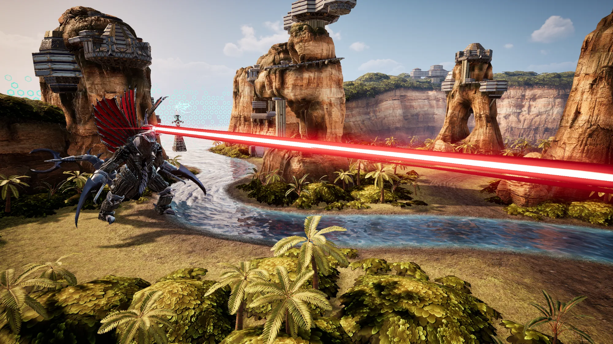

# Final Wars Gigan Skins (WIP)

Play as Final Wars Gigan in **Godzilla: Destroy All Monsters Melee Remastered**, with or without chainsaw arms.
Comes with a one-click skin switcher.

  

| | |
| --- | --- |
|  |  |
|  |  |
|  |  |

## Skins

- **Final Wars:** the Final Wars Gigan model from Godzilla Unleashed (Wii), with upscaled textures.
- **Chainsaw:** the same model with the chainsaw arms from Godzilla (PS3).

## Good to know

- This is a work in progress. The model was rebuilt to fit the Remastered skeleton, so expect some clipping and stretching in places.
- It uses the game's own animations, moves and hitboxes. Only the look changes.
- Offline use only. Use online at your own risk, or switch back to Showa before playing online.

## Install

1. Download **Gigan_Skin_Launcher_v0.3.zip** from the [latest release](../../releases/latest).
2. Extract it anywhere, for example your Desktop. Keep everything in the folder together.
3. Close the game.
4. Open the **Gigan Skin Launcher** folder and run **Gigan Skin Launcher.exe**.
5. Pick a skin and click **Apply & Play**.

The launcher finds the game through Steam on its own. If it can't, click **Browse for game folder** and pick the game's folder (the one that has GZPro in it).

Windows may show a SmartScreen warning because the launcher isn't signed. Click **More info**, then **Run anyway**.

### Install by hand

You can do it this way, but the launcher is a million times easier.

1. Download **Gigan_FW_Skins_v0.3_Files.zip** from the [latest release](../../releases/latest).
2. In Steam, right-click the game, then **Manage > Browse local files**.
3. Open `GZPro\Content\Paks` and create a folder named `~mods` if it isn't there.
4. Pick ONE skin folder, Final Wars or Chainsaw, and copy all three files inside it (`zGiganFW_P.pak`, `.ucas` and `.utoc`) into `~mods`.

To switch skins, delete those three files from `~mods` and copy in the three from the other folder.

## Uninstall

Pick Showa in the launcher and click Apply, or delete the three `zGiganFW_P` files from `GZPro\Content\Paks\~mods`.

## What's in this repo

- `launcher/` is the Gigan Skin Launcher (C#, .NET 10, Windows Forms). It copies the chosen skin's three files into `~mods`, removes only files it installed itself, and starts the game.
- `scripts/` and `build_all.ps1` are the pipeline that fits the Wii and PS3 models onto the game's skeleton (Blender) and packages them (Unreal Engine 5.8).
- `exporter/` is a small CUE4Parse tool used to read the game's skeleton, animations and textures.

The models and textures themselves aren't in the repo, only in the release downloads.

## Credits

Models from Godzilla Unleashed (Wii) and Godzilla (PS3). Built with CUE4Parse, UE4SS, Blender, Unreal Engine 5 and Real-ESRGAN.
